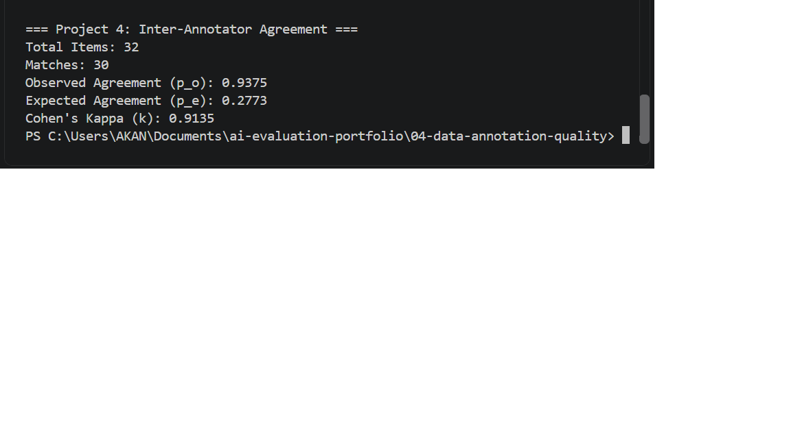

# Project 4: AI Data Annotation and Quality Assessment

A labelled dataset of 32 synthetic mobile-banking customer messages, a set of annotation guidelines, and an independent human–AI agreement test that identified ambiguities and led to revised guidelines.

**Note:** This is a learning portfolio project. All messages are synthetic. One of the two annotators was an AI model (Claude). The two annotators completed their labels independently before comparing their results. This project measures human–AI agreement, not human–human inter-annotator agreement.

## Objectives

- Develop annotation guidelines that can be applied consistently by different annotators.
- Measure annotation agreement using percent agreement and Cohen's kappa.
- Identify disagreements and determine whether they result from ambiguous or incomplete guidelines.
- Improve the guidelines based on observed disagreements.
- Document the methodology, findings and limitations of the evaluation.

## Task and Labels

Classify each customer message according to its primary intent using one of five labels:

**Complaint, Request, Question, Praise or Other.**

A priority order (Complaint → Request → Question → Praise → Other) is used to resolve messages containing multiple intents.

The complete label definitions, classification rules and examples are provided in [guidelines.md](guidelines.md).

The guidelines were revised after the initial agreement test. The changes and their reasons are documented in [agreement.md](agreement.md).

### Example Items and Labels

| Message | Label |
|---|---|
| "My transfer failed, but the money was deducted from my account." | Complaint |
| "What is the daily transfer limit on my account?" | Question |
| "Please block my ATM card immediately." | Request |
| "Thank you for helping me recover my account, but I still haven't received my refund." | Complaint |
| "Ur service aint bad at all. Really like it." | Praise |

All 32 messages are available in [items.md](items.md), and Annotator 1's labels are recorded in [labels-pass1.md](labels-pass1.md).

## Method

1. **Guideline development:** Created annotation guidelines defining five categories, their boundaries, priority rules and examples.
2. **Dataset creation:** Developed 32 synthetic customer messages covering different classification boundaries, including Complaint versus Question, Complaint versus Request, Praise versus Complaint, and Question versus Request. Several messages include informal English, abbreviations and spelling errors.
3. **Guideline freeze:** Finalised the original guidelines before the agreement test so both annotators worked from the same version.
4. **Independent annotation:** Annotator 1 (human) and Annotator 2 (Claude, an AI model) independently labelled all 32 messages using the written guidelines. Neither annotator had access to the other's labels during annotation.
5. **Agreement measurement:** Compared the completed annotations, constructed an agreement table and calculated percent agreement and Cohen's kappa.
6. **Disagreement analysis:** Investigated the two disagreements to identify ambiguities in the original guidelines.
7. **Guideline revision:** Updated the relevant definitions and rules to address the identified issues. The revised guidelines have not yet been independently retested.

## Results

| Measure | Result |
|---|---:|
| Total items | 32 |
| Matching labels | 30 |
| Disagreements | 2 |
| Percent agreement | 93.75% |
| Expected chance agreement | 0.277 |
| Cohen's kappa | 0.91 |

The annotators agreed on 30 of the 32 messages, producing 93.75% observed agreement. Cohen's kappa of approximately 0.91 indicates very high agreement beyond that expected by chance, based on the annotators' label distributions.

### Disagreements

| Item | Message | Annotator 1 | Annotator 2 | Guideline issue identified |
|---|---|---|---|---|
| 13 | "Nice one! Your app is very easy to use. Please add a dark mode." | Request | Praise | The original Request definition did not clearly cover feature suggestions or explain how to classify a message combining praise with a feature request. |
| 24 | "Can you help me check whether my account is eligible for a loan?" | Question | Request | The original Question-versus-Request rule did not clearly distinguish general information-seeking from asking the bank to perform a specific check. |

The full side-by-side labels, agreement table, calculations and disagreement analysis are available in [agreement.md](agreement.md).

## Findings

- **Ambiguous definitions can produce inconsistent labels.** Both disagreements exposed areas where the original guidelines did not provide sufficiently clear instructions.
- **Specific classification rules improve consistency.** The Question-versus-Request distinction needed clearer criteria to reduce overlapping interpretations.
- **Matching labels do not necessarily mean every rule is clear.** Items 11 and 15 received matching labels but still revealed useful boundary cases for reviewing the guidelines.
- **Agreement statistics need context.** Although the initial test produced high agreement, the small dataset and use of an AI annotator limit the conclusions that can be drawn.
- **Guideline improvements require further testing.** The revised rules address the observed disagreements, but their effectiveness has not yet been independently established.

## Limitations

- **Small dataset:** Only 32 messages were evaluated, limiting the generalisability of the findings.
- **Single human annotator:** The guidelines were written by Annotator 1, who also completed the first annotation. They were not independently developed or validated by multiple human annotators.
- **AI second annotator:** Annotator 2 was an AI model rather than a human. The results therefore represent human–AI agreement and may differ from human–human agreement.
- **Synthetic messages:** All messages were created for the project and may not fully represent the complexity, ambiguity and variation of real customer communications.
- **Limited disagreements:** Only two disagreements occurred, restricting the range of issues available for analysis.
- **Post-test revisions:** The guidelines were revised after reviewing the disagreements. The revised rules have not yet been tested in a new independent annotation round.

## Recommendations

- Test the revised guidelines using a fresh set of messages.
- Have both annotators complete the new annotations independently before comparing results.
- Increase the dataset size and include more varied and challenging borderline cases.
- Where possible, involve an independent human second annotator to compare human–human agreement with human–AI agreement.
- Document any remaining disagreements and refine the guidelines only when supported by the annotation evidence.

## Files

- [guidelines.md](guidelines.md): Current annotation guidelines, including revisions.
- [items.md](items.md): The 32 synthetic customer messages.
- [labels-pass1.md](labels-pass1.md): Annotator 1's original labels.
- [agreement.md](agreement.md): Side-by-side annotations, agreement calculations, disagreement analysis, limitations and conclusion.

### Automated Verification
The agreement metrics for this project can be independently verified by running the `kappa_calculator.py` script. Below is the output of the script:

